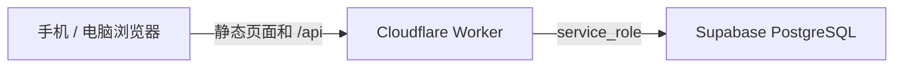

# 学生公寓查寝系统

一个面向高校学生公寓管理委员会的移动端查寝系统。查寝成员按组登录、逐间评分、上传现场照片并记录应到和实际到人数；管理员可以导入寝室分配、设置组员姓名、查看记录，并导出带照片的 Excel。

前端是可部署到 Cloudflare Workers 静态资源的单页应用，后端是同一域名下的 Cloudflare Worker，数据存储在 Supabase PostgreSQL。浏览器不直接持有数据库凭据。

## 功能

- 按组号进入本组负责的寝室列表
- 12 项查寝评分与总分、评级自动计算
- 应到人数、实际到人数录入和校验
- 实际到人数少于应到人数时填写未到寝人员姓名
- 每间寝室最多上传 5 张现场照片
- 本地草稿保存，断网或误刷新后可恢复
- 同组同寝室以最后一次提交为准
- 管理端 Excel 导入寝室分配
- 管理端按组维护组员姓名
- 后台记录查看、照片预览和批次清空
- 导出包含组员姓名、人数、评分、照片、备注和未到寝人员姓名的 Excel

## 技术架构



安全设计：

- 前端只访问同域名 `/api`
- Supabase `service_role` key 只保存在 Cloudflare Secret
- 管理员密码通过服务端校验并签发短期 HMAC token
- 所有写入均做字段白名单、类型、范围和长度校验
- Supabase 表启用 RLS，并撤销 `anon` / `authenticated` 权限

## 目录

```text
.
├─ web/                 # 前端单页和 SheetJS
├─ src/worker.js        # Cloudflare Worker API
├─ sql/schema.sql       # Supabase 初始化 SQL
├─ examples/            # 寝室分配表示例
├─ .github/workflows/   # 基础 CI
├─ package.json
└─ wrangler.toml
```

## 快速开始

### 1. 环境要求

- Node.js 20 或更高版本
- Cloudflare 账号
- Supabase 项目

### 2. 初始化数据库

在 Supabase SQL Editor 中执行 [sql/schema.sql](sql/schema.sql)。

### 3. 安装依赖

```bash
npm install
```

### 4. 配置 Cloudflare Secret

```bash
npx wrangler secret put SUPABASE_URL
npx wrangler secret put SUPABASE_SERVICE_KEY
npx wrangler secret put ADMIN_PASSWORD
npx wrangler secret put TOKEN_SECRET
```

各变量说明：

| 变量 | 内容 |
| --- | --- |
| `SUPABASE_URL` | Supabase 项目 URL，例如 `https://your-project.supabase.co` |
| `SUPABASE_SERVICE_KEY` | Supabase `service_role` key |
| `ADMIN_PASSWORD` | 自定的管理员登录密码 |
| `TOKEN_SECRET` | 至少 32 字节的高强度随机字符串 |

不要把 `service_role` key、管理员密码或 token secret 写入仓库。

### 5. 本地开发

```bash
npm run dev
```

### 6. 部署

```bash
npm run deploy
```

如需绑定自定义域名，在 [wrangler.toml](wrangler.toml) 中增加 `routes` 配置。

## 寝室分配表

管理端 Excel 至少需要以下列：

| 组号 | 寝室号 | 性别 |
| --- | --- | --- |
| 1 | 香樟3A104 | 女 |
| 1 | 香樟3A115 | 女 |

`性别` 可留空。可以参考 [examples/assignments-template.csv](examples/assignments-template.csv)。

## 主要接口

| 方法 | 路径 | 用途 |
| --- | --- | --- |
| `GET` | `/api/rooms?group=1` | 获取本组寝室 |
| `POST` | `/api/submit` | 提交查寝记录 |
| `POST` | `/api/admin/login` | 管理员登录 |
| `GET` | `/api/admin/records` | 获取记录 |
| `GET` | `/api/admin/groups` | 获取组员姓名 |
| `POST` | `/api/admin/groups` | 保存组员姓名 |
| `POST` | `/api/admin/import` | 导入寝室分配 |
| `POST` | `/api/admin/clear` | 清空当前批次记录 |

## 已知限制

- 照片以 Base64 形式保存在 PostgreSQL 文本字段中，适合小规模内部使用。记录量大时建议迁移到 Supabase Storage 或对象存储。
- 管理员 token 和提交频率限制保存在 Worker 实例内存中，不跨实例共享。生产环境可接入 Durable Objects、KV 或 Cloudflare Rate Limiting。
- 当前导出文件是 Excel 可打开的 `.xls` HTML 表格，不是标准 `.xlsx` OOXML 文件。

## 数据与隐私

项目不包含任何生产数据库、学生信息、查寝记录或导出的 Excel。部署者应自行配置数据库权限、管理员密码、隐私说明和数据保留周期。

## 第三方组件

前端使用 SheetJS Community Edition 的 `xlsx.full.min.js`。使用和分发前请阅读 [THIRD_PARTY_NOTICES.md](THIRD_PARTY_NOTICES.md)。

## 许可证

仓库默认未附带开源许可证。公开发布前请由项目所有者选择并添加合适的许可证。
